<!-- Generated. Edit README.template.md and profile.json, then run make. Numbers come from data/verification.json, which only CI writes. -->

<a href="https://github.com/smsabeidi/smsabeidi/blob/main/data/verification.json"><picture>
  <source media="(max-width: 767px) and (prefers-color-scheme: dark)" srcset="https://raw.githubusercontent.com/smsabeidi/smsabeidi/printout/assets/hero-phone-dark-ddd88fe6.svg">
  <source media="(max-width: 767px)" srcset="https://raw.githubusercontent.com/smsabeidi/smsabeidi/printout/assets/hero-phone-light-5aa0fdc1.svg">
  <source media="(prefers-color-scheme: dark)" srcset="https://raw.githubusercontent.com/smsabeidi/smsabeidi/printout/assets/hero-wide-dark-ddad4d2d.svg">
  
</picture></a>

Every number on that sheet was measured by [a CI job in this repo](https://github.com/smsabeidi/smsabeidi/blob/main/.github/workflows/printout.yml), not typed by me. Each week it clones my public repos, runs their test suites and self-checks, and reprints this page. A failed check prints here in red. Last run: 2026-11-04.

I'm looking for Summer 2027 internships in software engineering, quant development and applied AI. [Message me on LinkedIn](https://www.linkedin.com/in/muhammed-salim-a92a99341/).

### Records that can't be quietly rewritten

[**CareOS**](https://github.com/smsabeidi/careOS) is the backend of [Selmou AI](https://selmou.com), the healthcare operations platform I co-founded and am shaping with four pilot agencies. In home care the records are the compliance evidence, so the database treats history as append-only.

<a href="https://github.com/smsabeidi/careOS/blob/main/supabase/tests/database/004_audit_chain.sql"><picture>
  <source media="(max-width: 767px) and (prefers-color-scheme: dark)" srcset="https://raw.githubusercontent.com/smsabeidi/smsabeidi/printout/assets/ledger-phone-dark-e5d676c3.svg">
  <source media="(max-width: 767px)" srcset="https://raw.githubusercontent.com/smsabeidi/smsabeidi/printout/assets/ledger-phone-light-139f752d.svg">
  <source media="(prefers-color-scheme: dark)" srcset="https://raw.githubusercontent.com/smsabeidi/smsabeidi/printout/assets/ledger-wide-dark-f396efba.svg">
  
</picture></a>

Sample rows, real digests. Recompute them from `EVENTS` in [scripts/sheets.py](https://github.com/smsabeidi/smsabeidi/blob/main/scripts/sheets.py) with the formula in the migration.

- Every consequential action joins a per-tenant SHA-256 chain ([`0003_audit_chain.sql`](https://github.com/smsabeidi/careOS/blob/main/supabase/migrations/0003_audit_chain.sql)). A trigger blocks update and delete, and concurrent writers take an advisory lock so the chain can't fork.
- The test suite plays the insider. It disables that trigger as superuser, edits one row, and requires `verify_chain` to name that exact row while another tenant's chain still verifies ([`004_audit_chain.sql`](https://github.com/smsabeidi/careOS/blob/main/supabase/tests/database/004_audit_chain.sql)).
- n/a migrations and n/a pgTAP assertions across n/a suites. Row-level security is forced on every table, and CI fails if the live policies drift from the documented ones ([`gen-policies.sh`](https://github.com/smsabeidi/careOS/blob/main/scripts/gen-policies.sh)).

### A research harness that's allowed to say no

[**My quant research system**](https://github.com/smsabeidi/hft) exists to kill my own ideas before they cost money. A backtest that can't lose proves nothing, so the harness has to pass three tests on itself before it judges anything: a [zero-edge strategy must lose after costs](https://github.com/smsabeidi/hft/blob/main/scripts/run_falsification.py), [real strategies must fail on random walks](https://github.com/smsabeidi/hft/blob/main/scripts/run_synthetic_check.py), and [a planted edge must be found](https://github.com/smsabeidi/hft/blob/main/scripts/run_power_check.py).

<a href="https://github.com/smsabeidi/hft/blob/main/reports/rounds.log"><picture>
  <source media="(max-width: 767px) and (prefers-color-scheme: dark)" srcset="https://raw.githubusercontent.com/smsabeidi/smsabeidi/printout/assets/gauntlet-phone-dark-900dc3a0.svg">
  <source media="(max-width: 767px)" srcset="https://raw.githubusercontent.com/smsabeidi/smsabeidi/printout/assets/gauntlet-phone-light-13d82a10.svg">
  <source media="(prefers-color-scheme: dark)" srcset="https://raw.githubusercontent.com/smsabeidi/smsabeidi/printout/assets/gauntlet-wide-dark-fed4dd53.svg">
  
</picture></a>

- The noise test caught a flaw in my own gate: 51 lucky trades at t = 0.7 used to pass. That's why the gate now has minimum-trade and t-stat floors.
- 12 of 14 strategy variants are dead. London session breakout was still negative at zero cost, so the hypothesis was false, not just expensive.
- The survivor is delta-neutral funding carry on BTC and ETH: t = 3.50 over 31 out-of-sample episodes, about 3.8% a year at conservative costs. That's a small sample and a modest number, and I'm treating it that way.
- 153 tests, plus the three self-tests above, rerun weekly.

### An AI that refuses before it guesses

[**VisionAid**](https://github.com/smsabeidi/vision-aid) describes scenes and reads text aloud for blind and low-vision people, where a fluent wrong answer can hurt someone. So it fails closed.

- With no provider credential, live analysis returns a typed error and never a sample result ([test](https://github.com/smsabeidi/vision-aid/blob/main/tests/api-route.test.ts)).
- Model output that fails the strict schema is rejected ([test](https://github.com/smsabeidi/vision-aid/blob/main/tests/model-analysis.test.ts)).
- A street-crossing verdict classifies as critical, and action advice for an immediate hazard is stripped from the answer ([test](https://github.com/smsabeidi/vision-aid/blob/main/tests/safety.test.ts)).
- Retries are bounded, and a failing provider trips a circuit breaker ([test](https://github.com/smsabeidi/vision-aid/blob/main/tests/resilience.test.ts)).

60 tests pass on every run of the job above.

### Also built

- [**DashDrop**](https://www.dashdrop.ke): co-founded this regional ride and delivery product and [built its public site](https://github.com/smsabeidi/new-dashdrop-website) in Astro and TypeScript, with automated build tooling, production checks and the Vercel deploy.
- **FlyRoute Logistics**: sole developer of the [freight platform](https://www.flyroutelogistics.com/) behind a USA to Kenya shipper, with a customer tracking portal and a CRM. Spring Boot, React, PostgreSQL.
- **Vertex AI fact-checker**: 2nd place, competing solo, at the Google DevFest hackathon at Capitol Technology University in November 2025.
- [**MSLC platform**](https://github.com/smsabeidi/mslc): calculator loans and study-room booking for a Montgomery College learning center, replacing a spreadsheet workflow. 47 tests.

I also gave a TEDx talk, [Be Realistic: The Beautiful Lie](https://youtu.be/DMJHy5h8tUc). I'm a Presidential Scholar and a member of ColorStack and the National Society of Black Engineers.

### What this page does not claim

- No proven trading edge. One carry strategy passed its first round on 31 episodes, and nothing here is a live track record.
- CareOS's chain is tamper-evident, not tamper-proof. Someone with full database control could rewrite every later hash. The anchor table exists, but the job that exports the chain head to write-once storage isn't built yet.
- VisionAid hasn't had a security audit, an independent accessibility audit or clinical validation. It isn't for mobility, medical or emergency decisions.
- Test counts measure what was tested, not what was missed.

### Tools

Python, Java, C++, TypeScript, SQL. Spring Boot, Node.js, FastAPI, PostgreSQL, Supabase, Redis. AWS, Docker, Vercel, GitHub Actions. scikit-learn, TensorFlow, PyTorch.

How this page is printed

 

`scripts/verify.py` clones the repos above and runs their checks. `scripts/build.py` turns those measurements into the SVG sheets and this README, using only the Python standard library. [Tests](https://github.com/smsabeidi/smsabeidi/blob/main/tests/test_build.py) have to pass before the job can publish.

The verify job has read-only credentials and runs each repo's code. A separate job with write access runs only this repo's scripts. The contribution grid comes from GitHub's public calendar with no token and no third-party stats service.

The portrait came from one photo through background removal, tone mapping and glyph matching in `scripts/portrait.py`. The photo isn't in this repo. The approach follows [Avi Vashishta's guide](https://www.avivashishta.com/blog/build-animated-github-profile-readme) and [GitHub Profile Console](https://github.com/wildanniam/GitHub-Profile-Console). Type is IBM Plex Mono.

